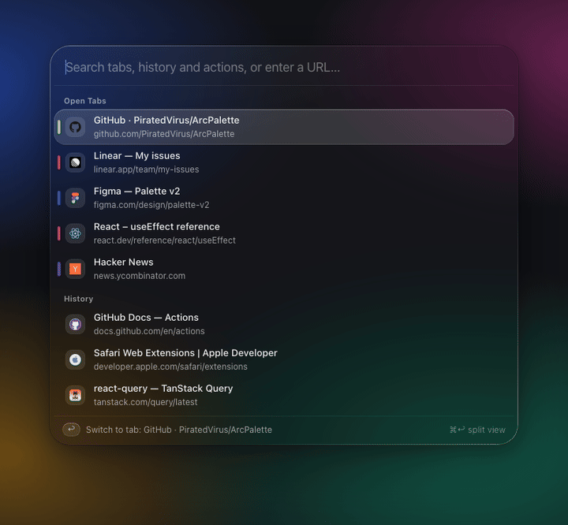
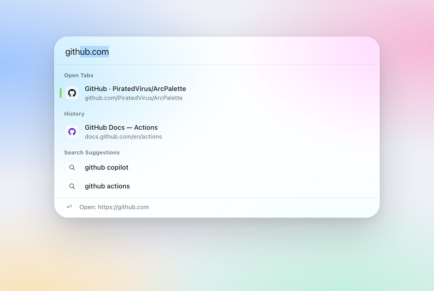
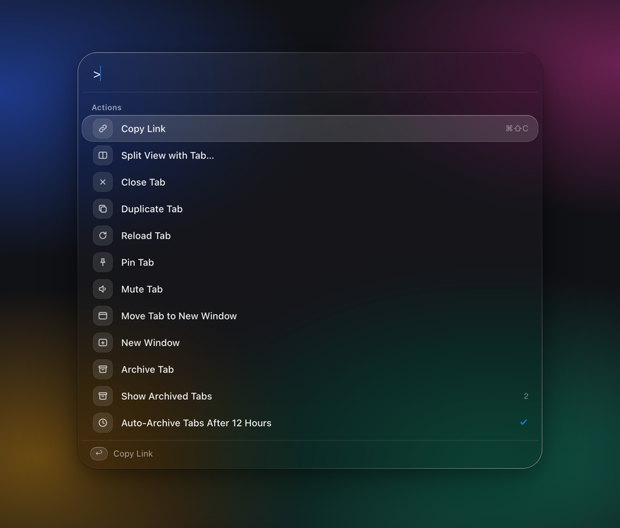
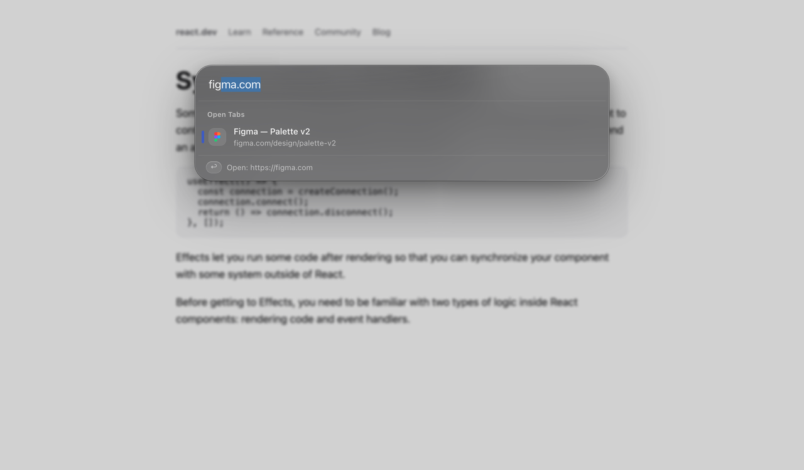

<div align="center">


# Arc Palette for Safari

**Arc's command bar, in Safari.** Search open tabs, history, actions and the web from one box.


 command mode lists tab actions" width="720">

</div>

## Why

Arc made one thing hard to give up: press **⌘T**, type a few letters, and land on the tab you already had open
instead of opening a duplicate. Safari's address bar searches tabs, but it buries them under suggestions.
Arc Palette brings back the Arc flow: one box, open tabs first, then history, then the web.

## Features

- **Tabs first.** ⌘T opens a new tab *as the palette*. Pick an open tab and the blank tab closes itself, so you
  never pile up duplicates.
- **Inline completion.** Type `gith` and it completes to `github.com` like Arc and Safari's address bar. Press → to accept.
- **History that's actually yours.** Visits are ranked by how often and how recently you opened them.
- **Command mode.** Type `>` for tab actions: copy link, split view, pin, mute, duplicate, move to a new window,
  archive.
- **Split View.** Put any tab side by side with the current one; the two Safari windows tile across the screen.
- **Auto-archive.** Tabs you haven't touched in 12 hours, 24 hours or 7 days are closed and kept in a searchable
  archive, the way Arc does it (12 hours by default). Pinned tabs and tabs playing audio are never archived.
  Reopen them from **Show Archived Tabs**.
- **On top of any page.** ⌥T opens the palette as an overlay without leaving the page.
- **Light and dark.** A frosted-glass look that follows the system appearance.

<table>
<tr>
<td width="50%"></td>
<td width="50%"></td>
</tr>
<tr>
<td colspan="2"></td>
</tr>
</table>

## Shortcuts

| Keys | Does |
|---|---|
| **⌘T** | New tab opens as the palette. Esc cancels it. |
| **⌥T** | Palette on top of the current page (also the toolbar button) |
| **⌘⇧C** | Copy the current page's link |
| ↑ / ↓ or Tab | Move the selection |
| → | Accept the inline completion |
| ↩ | Open in a new tab (or switch to the open tab) |
| ⇧↩ | Open in the current tab |
| ⌘↩ | Open in Split View |
| `>` | Command mode: tab actions only |
| Esc | Close (or leave a sub-list like Split View / Archived) |

## Install

> **The app isn't signed with an Apple Developer ID**, so macOS and Safari need two one-time steps.
> Everything below is standard for open-source Safari extensions distributed outside the App Store.

### Option A: prebuilt app (macOS 27+)

1. Download `Arc-Palette.zip` from the [latest release](../../releases/latest) and unzip it.
2. Move **Arc Palette.app** to `/Applications`, then clear the download quarantine flag:
   ```bash
   xattr -dr com.apple.quarantine "/Applications/Arc Palette.app"
   ```
3. In Safari: **Settings → Advanced → Show features for web developers**, then
   **Develop → Developer Settings… → Allow unsigned extensions**.
4. Open **Arc Palette.app** once, then enable it in **Safari → Settings → Extensions**, and allow it on all websites.

Safari turns **Allow unsigned extensions** off every time it quits, so repeat step 3 after restarting Safari. This is
Safari's rule for any unsigned extension; a signed build from the Mac App Store wouldn't need it.

### Option B: build from source

Needs Xcode.

```bash
git clone https://github.com/PiratedVirus/ArcPalette.git
open "ArcPalette/Arc Palette/Arc Palette.xcodeproj"
```

Select the **Arc Palette** scheme, set your own team under *Signing & Capabilities* (a free personal team works),
and press ⌘R. On macOS older than 27, lower the app target's **Minimum Deployments** first; the extension
itself targets macOS 12.

## Settings

**Search engine:** Google by default. To switch to DuckDuckGo, open **Develop → Web Extension Background Content →
Arc Palette** and run:

```js
browser.storage.local.set({ settings: { engine: "duckduckgo" } })
```

**Auto-archive:** type `>archive` in the palette and pick 12 hours, 24 hours, 7 days, or off.

## Privacy

- Your history, archive and settings live in the extension's local storage on your Mac. Nothing is synced or uploaded.
- When you type a search, the text is sent to the search engine's suggestion endpoint (Google or DuckDuckGo), the
  same as typing in Safari's address bar.
- Favicons for history items load from `icons.duckduckgo.com`.
- No analytics, no accounts.

## How it's built

| Path | What it is |
|---|---|
| `extension/palette.js` | The palette UI. Mounts into a page or a closed shadow root, so site CSS can't touch it |
| `extension/background.js` | Service worker: tab and history search, ranking, suggestions, actions, auto-archive alarms |
| `extension/content.js` | Overlay host, toasts and ⌘⇧C on every page |
| `extension/newtab.*` | The ⌘T new-tab page that *is* the palette |
| `Arc Palette/` | The Xcode wrapper app Safari requires; `SafariWebExtensionHandler.swift` tiles windows for Split View |

No build step and no dependencies: the extension is plain JavaScript.

## Contributing

Issues and PRs are welcome. Good first areas: a settings page (instead of the console snippet above), more search
engines, and keyboard-shortcut customisation.

## License

[MIT](LICENSE) © 2026 Saurabh Kulkarni. Not affiliated with The Browser Company or Apple.
